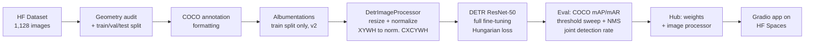

# Trashify: End-to-End Object Detection with DETR

Fine-tuning a COCO-pretrained **DEtection TRansformer (DETR, ResNet-50)** to verify waste-cleanup actions. The system detects `bin`, `hand`, and `trash` in a photo and awards **+1 point** only when all three appear together.

[GitHub](https://github.com/jobigutenburg02/trashify-object-detector) | [Live Demo (Hugging Face Space)](https://huggingface.co/spaces/johanbkg2513/trashify-object-detector-demo-v2) | [Model v2 (Hub)](https://huggingface.co/johanbkg2513/detr_resnet50_finetuned_trashify_box_detector_v2) | [Model v1 (Hub)](https://huggingface.co/johanbkg2513/detr_resnet50_finetuned_trashify_object_detector_v1)

**Stack:** PyTorch, Hugging Face Transformers / Datasets / Hub, Albumentations, torchvision, torchmetrics (COCO mAP), Gradio, Hugging Face Spaces.

---

## Table of Contents

1. [TL;DR and headline results](#1-tldr-and-headline-results)
2. [Problem statement](#2-problem-statement)
3. [Dataset](#3-dataset)
4. [Pipeline overview](#4-pipeline-overview)
5. [Background: how DETR works](#5-background-how-detr-works)
6. [Implementation details](#6-implementation-details)
7. [Training: v1 baseline vs v2 recipe](#7-training-v1-baseline-vs-v2-recipe)
8. [Evaluation methodology](#8-evaluation-methodology)
9. [Results in full](#9-results-in-full)
10. [Deployment](#10-deployment)
11. [Limitations and honest caveats](#11-limitations-and-honest-caveats)
12. [Future work](#12-future-work)
13. [Reproducing this project](#13-reproducing-this-project)
14. [Credits and references](#14-credits-and-references)

---

## 1. TL;DR and headline results

I fine-tuned `facebook/detr-resnet-50` on a small, hand-labelled dataset (1,128 images) and iterated from a baseline (**v1**) to an improved recipe (**v2**). All numbers below are on a **held-out test split of 224 images** that was never used for training, checkpoint selection, or threshold tuning.

| Metric (test set) | v1 baseline | v2 | Change |
|---|---|---|---|
| mAP@50, target classes (`bin`/`hand`/`trash`) | 61.6% | **83.3%** | +21.7 pts |
| mAP@[.5:.95], target classes | 39.5% | **56.5%** | +17.0 pts |
| mAP@50, all 7 classes | 27.6% | 38.4% | +10.9 pts |
| mAP@[.5:.95], all 7 classes | 17.4% | 25.9% | +8.5 pts |
| Macro-F1 at validation-tuned threshold | 71.0% | **81.1%** | +10.1 pts |
| Joint detection rate (bin + hand + trash) | 56.8% | **83.1%** | +26.3 pts |
| Mean end-to-end latency (T4 GPU, batch 1) | 44.0 ms | 43.1 ms | about the same |

What I want a reader to take away:

- **End-to-end ownership:** data validation, annotation format conversion, training, evaluation, threshold calibration, packaging, and deployment.
- **Evaluation rigor:** train/val/test split with a fixed seed, threshold tuned on validation only, a product-level metric on top of box-level mAP, and explicit reporting of which class average each number refers to.
- **Honesty about limits:** v2 changed three things at once (no ablation), the test set is small and comes from a single image source, and 7-class mAP is dragged down by rare "negative" classes (see [Section 11](#11-limitations-and-honest-caveats)).

---

## 2. Problem statement

A cleanup-verification feature (think "earn points for picking up litter") needs to decide from a photo whether a person is actually performing a disposal action. A reasonable proxy is the **co-occurrence of three entities** in the same image:

- a `bin` (the destination),
- a `hand` (the actor), and
- `trash` (the object being disposed of).

So the engineering problem has two layers:

1. **Perception:** localize and classify these objects accurately (box-level detection, measured by COCO mAP).
2. **Decision:** turn raw detections into a yes/no verification (needs a confidence threshold, duplicate suppression, and a product-level metric, measured by the joint detection rate).

Box-level mAP alone does not tell you whether the feature works, which is why the project defines and reports the joint detection rate separately.

---

## 3. Dataset

- **Source:** [`mrdbourke/trashify_manual_labelled_images`](https://huggingface.co/datasets/mrdbourke/trashify_manual_labelled_images) on the Hugging Face Hub (public dataset; I did not collect it). Images were manually photographed and labelled with Prodigy (`image_source = manual_taken_photo`, `label_source = manual_prodigy_label`).
- **Size:** 1,128 images, typically 960x1280 RGB.
- **Annotation format:** COCO-style absolute-pixel **XYWH** boxes (`[x_min, y_min, width, height]`) plus `category_id` and `area`.
- **Classes (7):**

| ID | Class | Role |
|---|---|---|
| 0 | `bin` | Target: waste or recycling receptacle |
| 1 | `hand` | Target: human hand |
| 5 | `trash` | Target: litter item |
| 6 | `trash_arm` | Context: arm region associated with trash handling |
| 2 | `not_bin` | Hard negative: bin-like object that is not a bin |
| 3 | `not_hand` | Hard negative: hand-like object |
| 4 | `not_trash` | Hard negative: ground cover or non-litter |

- **Splits** (seed 42, two-stage `train_test_split`):
  1. 70% train / 30% holdout.
  2. Holdout split again into validation and test.
  - Result: **789 train / 115 validation / 224 test**. An assertion checks that the three splits sum to the original 1,128 (no leakage or loss).
- **Eligible test images:** 183 of the 224 test images (81.7%) contain all three of `bin`, `hand`, `trash` in the ground truth. These are used for the joint detection metric.

I visualized ground-truth boxes (XYWH to XYXY via `torchvision.ops.box_convert`, drawn with `draw_bounding_boxes`) on random samples to confirm the coordinates were not shifted, swapped, or inverted before training anything.

---

## 4. Pipeline overview



---

## 5. Background: how DETR works

This section exists so I can explain the model, not just run it.

**Architecture** (`facebook/detr-resnet-50`, pretrained on COCO 2017):

1. **CNN backbone (ResNet-50):** turns the image into a feature map (2048 channels at 1/32 resolution), projected to hidden dimension d = 256. Batch-norm layers are frozen (`DetrFrozenBatchNorm2d`).
2. **Transformer encoder (6 layers, 8 heads):** self-attention over the flattened feature map with 2D positional encodings, giving each location global context.
3. **Transformer decoder (6 layers):** takes **100 learned object queries**; each query cross-attends to the encoder output and becomes one prediction slot.
4. **Prediction heads:** a linear classifier (`class_labels_classifier`) outputs class logits, and a 3-layer MLP (`bbox_predictor`) outputs normalized `[cx, cy, w, h]` boxes.

**Set prediction instead of anchors + NMS.** Classic detectors (Faster R-CNN, older YOLO) rely on hand-designed anchors and non-maximum suppression. DETR predicts a fixed set of 100 (class, box) pairs in parallel. Since there are usually far fewer than 100 real objects, most queries must predict a special **"no object"** class. That is why the classifier here has **8 outputs = 7 classes + 1 no-object** (the pretrained checkpoint has 92 = 91 COCO classes + no-object, so the head is re-initialized with `ignore_mismatched_sizes=True`; the backbone and transformer weights are kept).

**Hungarian (bipartite) matching loss.** During training, predictions are matched one-to-one with ground-truth objects using the Hungarian algorithm, minimizing a cost made of class probability, L1 box distance, and generalized IoU. The loss is then computed on matched pairs (unmatched queries are pushed toward "no object"). The notebook logs three components: `loss_ce` (classification), `loss_bbox` (L1 on boxes), and `loss_giou` (generalized IoU), plus `cardinality_error` (a diagnostic of how far the number of predicted objects is from the true count). Matching is what lets DETR train without NMS, because duplicates are penalized by construction.

**Box coordinate conventions** (a common source of bugs; the pipeline converts explicitly between them):

| Stage | Format |
|---|---|
| Dataset annotations | Absolute **XYWH** (COCO) |
| DETR training targets and raw outputs | **Normalized CXCYWH** (values in [0, 1]) |
| Post-processed predictions / drawing / mAP | Absolute **XYXY** (torchvision) |

Normalization: `x_norm = x_abs / W`, `y_norm = y_abs / H` (same for w, h). `post_process_object_detection` handles the CXCYWH-to-XYXY conversion and rescaling to the original image size using `target_sizes` (height, width order).

**Score computation at inference:** apply softmax over the 8 logits per query, drop the no-object column, and take the max over the 7 real classes as the query's score and label. I re-implemented this manually in the notebook and verified that it matches the library output (a numerical-equivalence check on boxes and scores).

---

## 6. Implementation details

### 6.1 Annotation formatting
`format_image_annotations_as_coco` converts the dataset's columnar annotations (`bbox`, `category_id`, `area`) into the nested COCO structure the image processor expects (`{"image_id": ..., "annotations": [{image_id, category_id, bbox, area}, ...]}`), using small dataclasses (`SingleCOCOAnnotation`, `ImageCOCOAnnotations`).

### 6.2 Image preprocessing
`AutoImageProcessor` (fast version) configured with:

- `size = {"shortest_edge": 640, "longest_edge": 640}`: images are resized to fit within 640 px (aspect ratio preserved) instead of DETR's default of up to 800x1333. This was chosen to keep memory manageable on a 16 GB T4.
- `do_convert_annotations=True`: boxes become normalized CXCYWH automatically.
- `do_pad=True`: images in a batch are padded to the same size, and a `pixel_mask` marks real vs padded pixels.
- ImageNet normalization (mean `[0.485, 0.456, 0.406]`, std `[0.229, 0.224, 0.225]`).

`preprocess_batch` runs the COCO formatting and the processor on a whole batch and **fails early** if any preprocessed box contains non-finite values. (A bug found and fixed along the way: returning from inside the per-image loop silently dropped every image except the first in a batched call; the processor call now happens after the loop.)

### 6.3 Data loading
- Preprocessing is applied lazily via `dataset.with_transform(...)`.
- A custom `data_collate_function` stacks `pixel_values` (and `pixel_mask` if present) and keeps `labels` as a list of dicts, which is the structure DETR's loss expects.
- `remove_unused_columns=False` is required in `TrainingArguments`, otherwise the Trainer would drop the `labels` structure.

### 6.4 Metric computation inside the Trainer
`eval_compute_metrics_fn` post-processes predictions (threshold 0.0 so all 100 queries are kept), then uses `torchmetrics.detection.MeanAveragePrecision` with `max_detection_thresholds=[1, 10, 100]` and per-class metrics. It reports mAP, mAP@50, mAP@75, small/medium/large breakdowns, mAR@1/10/100, and per-class mAP and mAR. `eval_do_concat_batches=False` keeps batches separate because each batch has a different list of boxes.

---

## 7. Training: v1 baseline vs v2 recipe

Both versions use **full fine-tuning** (all 41.5M parameters trainable: 23.5M in the backbone and 18.0M in the transformer and heads), the Hugging Face `Trainer`, mixed precision (`fp16`), gradient clipping at 0.1, and weight decay 1e-4.

| Setting | v1 (baseline) | v2 |
|---|---|---|
| Epochs | 10 | **20** (about 1,000 optimizer steps) |
| LR schedule | Linear decay, 5% warmup | **Cosine decay**, 5% warmup |
| Learning rate | 1e-4 for all parameters | **1e-5 backbone / 1e-4 transformer + heads** (AdamW with two parameter groups) |
| Augmentation | None | **Albumentations on the train split only** |
| Per-device batch size | 4 | 4 |
| Gradient accumulation | 4 (effective batch **16**) | 4 (effective batch **16**) |
| Best-checkpoint criterion | Lowest validation loss | Lowest validation loss |
| Final train loss | 1.192 | 1.086 |
| Best validation loss | 1.165 | 1.019 |
| Final validation mAP (7 classes, at threshold 0) | 0.2013 | 0.2987 |

### v2 augmentation pipeline (boxes are transformed with the image)

| Transform | Settings | Purpose |
|---|---|---|
| `HorizontalFlip` | p = 0.5 | See both left- and right-handed disposal |
| `ShiftScaleRotate` | shift 0.0625, scale 0.15, rotate 15 degrees, p = 0.5 | Small viewpoint and distance changes |
| `ColorJitter` | brightness/contrast/saturation 0.25, hue 0.05, p = 0.5 | Lighting variation |
| `GaussianBlur` | blur limit 3-5, p = 0.2 | Mild defocus and motion blur |

Box handling: `BboxParams(format="coco", min_area=16, min_visibility=0.2)` drops boxes that become degenerate or mostly cropped out. If Albumentations rejects a sample (for example, a box slightly outside the image), the code falls back to the un-augmented sample. A sanity check showed **augmentation succeeded on 199 of 200** sampled training images.

**Augmentation is applied to the training split only.** Validation and test stay un-augmented so that evaluation reflects real images.

### Why these choices (and the caveat)
- **Differential learning rates** follow standard DETR practice: the pretrained backbone should change slowly, while the transformer and freshly initialized head need larger steps.
- **Gradient clipping at 0.1** and weight decay 1e-4 come from the DETR paper's recipe and help stabilize attention training.
- **Augmentation** targets the main risk of a 789-image training set: overfitting and sensitivity to lighting and handedness.
- **Caveat:** v2 changed augmentation, schedule, and learning rates **at the same time**, so the v1-to-v2 gain measures the whole recipe, not any single change. No per-component ablation was run.
- **Observation:** the best v2 checkpoint was `checkpoint-1000`, the **last step**. Validation loss was still improving at epoch 20, so the model had not clearly overfit and more epochs might help.

---

## 8. Evaluation methodology

### 8.1 Box-level: COCO mAP / mAR
- `torchmetrics` MeanAveragePrecision on the 224 test images, with all 100 queries kept (**threshold 0.0**), which is the correct setting for AP (AP needs the full ranking of scores).
- **mAP@50:** AP at IoU 0.50. **mAP@[.5:.95]:** mean over ten IoU thresholds from 0.50 to 0.95 (the stricter COCO headline metric). **mAP@75:** strict localization.
- **mAR@1/10/100:** average recall given at most 1, 10, or 100 detections per image.
- **Two averages are reported, and the label matters:**
  - *Target mAP*: mean over `bin`, `hand`, `trash`, the three classes the product depends on.
  - *7-class mAP*: mean over all classes, including rare negatives that drag the average down.

### 8.2 Operating point: confidence threshold + NMS
At threshold 0 DETR returns all 100 queries, which is useless for a product. To pick a deployable threshold **without touching the test set**:

1. Sweep the confidence threshold tau from 0.10 to 0.95 on the **validation** split.
2. At each tau: apply **class-wise NMS (IoU 0.5)**, greedily match predictions to ground truth by score (IoU >= 0.5), and compute precision, recall, and F1 per target class.
3. Choose the tau with the best **macro-F1 over `bin`, `hand`, `trash`** on validation, separately for each model.
4. Report precision, recall, and F1 on the **test** split at that tau* (and at the default 0.50 for reference).

Result: **v1 tau\* = 0.50, v2 tau\* = 0.60.**

### 8.3 Product metric: joint detection rate
Box-level AP does not measure whether the "+1 point" rule works, so I defined:

- **Eligible images:** test images whose ground truth contains all of `bin`, `hand`, `trash` (183 images).
- **Hit:** after confidence filtering and class-wise NMS, each of the three classes has at least one predicted box with **IoU >= 0.5** against a ground-truth box of the same class.
- **Joint detection rate = hits / eligible images.**

This is a **recall-style** metric: it tells how often a genuine cleanup would be verified. It does **not** measure how often a non-cleanup image is wrongly verified, so it should always be quoted as "joint detection rate on eligible images", never as overall accuracy.

### 8.4 Latency
Measured on 50 real test images after 5 warm-up runs, batch size 1, **fp32** inference, with GPU synchronization around the timer. It includes preprocessing, the forward pass, and post-processing, so it is end-to-end rather than model-only.

---

## 9. Results in full

### 9.1 Per-class test AP (%)

| Class | v1 AP@50 | v1 AP@[.5:.95] | v2 AP@50 | v2 AP@[.5:.95] |
|---|---|---|---|---|
| `bin` | 59.5 | 43.5 | **88.1** | **67.0** |
| `hand` | 63.5 | 39.9 | **77.7** | **49.7** |
| `trash` | 62.0 | 35.2 | **84.1** | **52.9** |
| `not_trash` | 8.0 | 3.3 | 19.2 | 11.8 |
| `not_bin` | 0.0 | 0.0 | 0.0 | 0.0 |
| `not_hand` | 0.0 | 0.0 | 0.0 | 0.0 |
| `trash_arm` | 0.0 | 0.0 | 0.0 | 0.0 |
| **Target mean (bin/hand/trash)** | 61.6 | 39.5 | **83.3** | **56.5** |
| **All 7 classes** | 27.6 | 17.4 | 38.4 | 25.9 |

The four non-target classes have few boxes and are rarely learned (three score exactly 0 AP). That is why the 7-class average is much lower than the target average. The two numbers measure different things and must not be mixed.

### 9.2 v1 baseline detail (test, all 7 classes, threshold 0)

| mAP | mAP@50 | mAP@75 | mAP small | mAP medium | mAP large | mAR@1 | mAR@10 | mAR@100 |
|---|---|---|---|---|---|---|---|---|
| 0.174 | 0.276 | 0.190 | 0.000 | 0.061 | 0.177 | 0.218 | 0.346 | 0.369 |

Note that small-object AP and recall were **exactly zero** for v1. At 640 px input, small objects (typically small litter) are effectively invisible to the model. This is a documented weakness of DETR on small objects, made worse by downscaling.

### 9.3 Precision / recall / F1 on test at the operating threshold

| Model | Threshold | bin P | hand P | trash P | bin R | hand R | trash R | Macro-F1 |
|---|---|---|---|---|---|---|---|---|
| v1 | 0.50 (= tau\*) | 86.0 | 57.7 | 63.9 | 70.2 | 87.4 | 68.6 | 71.0 |
| v2 | 0.50 | 79.3 | 59.0 | 74.8 | 88.6 | 96.5 | 87.3 | 79.1 |
| v2 | **0.60 (= tau\*)** | **87.2** | 60.9 | **79.1** | 87.2 | 94.4 | 85.3 | **81.1** |

Reading this table: raising v2's threshold from 0.50 to 0.60 trades a little recall for much better precision on `bin` (79.3 to 87.2) and `trash` (74.8 to 79.1), which is why validation chose 0.60. **`hand` precision stays low (about 60%)** for both models, so hand false positives are the clearest remaining weakness at the box level.

### 9.4 Joint detection rate on 183 eligible test images

| Model | Threshold | bin found | hand found | trash found | **Joint rate** |
|---|---|---|---|---|---|
| v1 | 0.50 | 85.2% | 87.4% | 73.2% | **56.8%** |
| v2 | 0.50 | 98.4% | 96.2% | 89.6% | 85.2% |
| v2 | 0.60 (tau\*) | 97.8% | 94.0% | 89.1% | **83.1%** |

`trash` is the bottleneck in the joint metric (lowest per-class "found" rate), consistent with it being the smallest and most amorphous class.

### 9.5 Latency (NVIDIA Tesla T4, batch 1, fp32, end-to-end)

| | v1 | v2 |
|---|---|---|
| Mean | 44.0 ms | 43.1 ms |
| Median | 42.7 ms | 42.2 ms |
| p95 | 49.4 ms | 50.0 ms |
| Throughput | 22.7 img/s | 23.2 img/s |

Latency is essentially unchanged between versions, which is expected: v2 changes training only, not the architecture.

---

## 10. Deployment

**Model artifact:** weights, config, and the **image processor** (so inference inherits identical resize and normalization) are pushed to the Hugging Face Hub as `detr_resnet50_finetuned_trashify_box_detector_v2`.

**Service:** a Gradio app (`app.py`) hosted on a Hugging Face Space.

Flow of `predict_on_image(image, conf_threshold=0.50, nms_iou_threshold=0.50)`:

1. Preprocess with the image processor and run the model (`torch.no_grad`, eval mode).
2. `post_process_object_detection` with the user's confidence threshold and `target_sizes=(H, W)` to get absolute XYXY boxes.
3. **Class-wise NMS** (`torchvision.ops.nms` per class) to remove duplicates.
4. Draw colored boxes and scores with `PIL.ImageDraw`.
5. **Verification logic:** if the set of detected labels includes all of `{bin, hand, trash}`, return "+1 Point!"; otherwise report which items are missing.

Other details:
- A **fallback** loads the v1 model if the v2 repo cannot be loaded.
- A `@spaces.GPU` decorator (with a no-op stub on CPU Spaces) makes the same code work on ZeroGPU or CPU hardware.
- The UI exposes a **confidence slider (0.1 to 0.9)**; the default is 0.50 while the validation-tuned value for v2 is 0.60. If asked: 0.60 is the calibrated optimum, 0.50 is the UI default.
- Three bundled example images allow one-click demos. The runtime manifest is `timm, gradio, torch, torchvision, transformers, pillow`.

---

## 11. Limitations and honest caveats

These are the things a careful reviewer should know, and I would rather state them than have them discovered.

1. **No ablation.** v2 changed augmentation, schedule length, and learning rates together. The gain is attributable to the recipe as a whole, not to any single change.
2. **Small, single-source evaluation.** The test set has 224 images, all with `image_source = manual_taken_photo`. There is no breakdown by viewpoint or camera, and no confidence intervals. Results come from a single training run (one seed), so small differences should not be over-interpreted.
3. **Target-class vs 7-class mAP.** Headline numbers use the three target classes. The negative classes (`not_bin`, `not_hand`) and `trash_arm` score 0 AP, and `not_trash` reaches 19.2 AP@50, so the 7-class mAP is 38.4% for v2.
4. **Joint detection rate is recall-only.** It does not quantify false verifications on images that are not real cleanups. A false-accept rate would require a labelled set of negative images, which I did not build.
5. **Out-of-distribution robustness is not established.** I ran the model on a single external web image (a person putting trash in a bin); in that check only the `bin` was detected (score 0.79), with `hand` and `trash` missed. One image is an anecdote, not a study, but it suggests the model may not generalize well to different viewpoints.
6. **Small objects.** The v1 test results show zero AP/recall for small objects, and `trash` is the weakest class in the joint metric. Input resolution is capped at 640 px.
7. **`hand` precision is about 60%** at the operating threshold, so false-positive hands are the main box-level error mode. I have hypotheses (confusion with `not_hand`, `trash_arm`, or background) but did not run a confusion analysis, so I do not claim a cause.
8. **Checkpoint selection used validation loss, not mAP.** It is simple and stable, but validation mAP could select a different epoch.
9. **Warmup specification.** `WARMUP_RATIO = 0.05` is passed through the `warmup_steps` argument in `TrainingArguments`. Depending on the Transformers version, a float below 1 may be interpreted as a ratio; if reproducing exactly, verify how your installed version treats it.
10. **Latency was measured on a T4 in fp32** (training used fp16, inference did not). It was not measured on CPU or mobile hardware, and no export (ONNX, TensorRT) or quantization was attempted.

---

## 12. Future work

- **Ablate** each v2 change (augmentation only, schedule only, differential LR only) with multiple seeds and report confidence intervals.
- **Build a negative evaluation set** (images that are not cleanups) to measure the **false-accept rate** of the +1 rule, and report precision/recall of the verification decision, not just recall.
- **Add spatial reasoning to the rule:** require the `hand` box to overlap or be near the `trash` box and the `bin` box, rather than only co-occurrence anywhere in the image. This would cut false verifications.
- **Higher resolution / small-object handling:** tiling, larger input size, or a multi-scale model such as Deformable DETR.
- **Compare against other detectors** (for example YOLO or RT-DETR) on the same splits and report accuracy vs latency.
- **Hard-negative mining** and more data for `not_*` classes and `trash_arm`, or drop those classes if they are not needed for the product.
- **Per-source / per-viewpoint evaluation** once the data includes more than one source, and a proper OOD test set.
- **Production hardening:** ONNX/TensorRT export, fp16 inference, batching, CPU latency numbers, input validation, and monitoring.
- **Train longer:** the best v2 checkpoint was the final one, so there may be headroom.

---

## 13. Reproducing this project

The full workflow is in the notebook (`trashify_object_detector.ipynb`). It was developed on a Google Colab **Tesla T4 (16 GB)** GPU.

```bash
pip install -U datasets gradio "torchmetrics[detection]" pycocotools albumentations timm transformers torch torchvision pillow
```

Then run the notebook top to bottom. In order, it:

1. Loads and inspects the dataset and visualizes ground-truth boxes.
2. Creates the 70/15/15-style split (seed 42): 789 / 115 / 224 images.
3. Builds the model, image processor, annotation formatter, collator, and metric function.
4. Trains **v1** (10 epochs) and **v2** (20 epochs, augmentation, differential LR).
5. Evaluates both on the test set (mAP/mAR, per class, threshold sweep, joint detection, latency).
6. Saves and pushes the v2 model and image processor to the Hub (requires `notebook_login()` with your own token and username).
7. Writes `app.py`, `requirements.txt`, and the Space `README.md` and uploads the folder to a Hugging Face Space.

**Suggested repository layout** (adjust to match your repo):

```
trashify-object-detector/
├── trashify_object_detector.ipynb      # full workflow
├── demos/
│   └── trashify_object_detector/
│       ├── app.py                       # Gradio inference service
│       ├── requirements.txt
│       ├── README.md                    # Space metadata + results
│       └── trashify_examples/           # 3 demo images
└── models/                              # checkpoints (gitignored)
```

To run only the demo locally:

```bash
cd demos/trashify_object_detector
pip install -r requirements.txt
python app.py
```

---

## 14. Credits and references

- **Dataset:** [Trashify manually labelled images](https://huggingface.co/datasets/mrdbourke/trashify_manual_labelled_images) by Daniel Bourke (public dataset on the Hugging Face Hub). The project structure follows the Trashify object-detection tutorial; the v2 training recipe, threshold calibration, joint-detection metric, latency profiling, and deployment are my additions as documented in this README.
- Carion, N., Massa, F., Synnaeve, G., Usunier, N., Kirillov, A., Zagoruyko, S. (2020). *End-to-End Object Detection with Transformers.* ECCV. [arXiv:2005.12872](https://arxiv.org/abs/2005.12872)
- Lin, T.-Y. et al. (2014). *Microsoft COCO: Common Objects in Context.* ECCV. [arXiv:1405.0312](https://arxiv.org/abs/1405.0312)
- Libraries: PyTorch, Hugging Face Transformers / Datasets / Hub, Albumentations, torchvision, torchmetrics, Gradio.

License note: the base DETR checkpoint and the Space metadata use Apache-2.0; check the dataset card for the dataset's own license before redistributing derived data.
